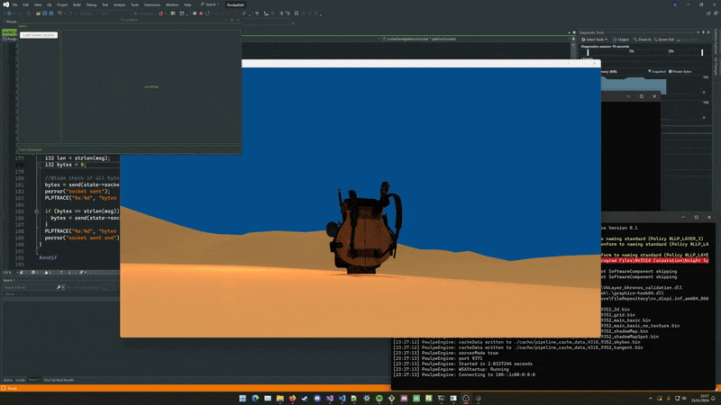

# PoulpeEdit

PoulpeEdit is the level editor that comes with [PoulpeEngine](https://github.com/galliume/poulpeEngine)

### This project is a never ending educationnal exercice about Tcl/TK and game level editor.

[State of the project](https://github.com/users/galliume/projects/5)

[In video](https://www.youtube.com/watch?v=C7p9z6LhAig&list=PL4-Os8BWDCPmZt5HvJrSo6QDHkD9J4fJF)



## Build Tcl/Tk 
[Download the latest version of Tcl/Tk](https://www.tcl-lang.org/software/tcltk/download.html)

## Windows :
Then in the developer command prompt shell load vcvars64.bat (should be here:)
```
C:\Program Files\Microsoft Visual Studio\2022\Community\VC\Auxiliary\Build\vcvars64.bat
```

Build first TCL from the source 
```
cd tcl9.0.1\win
nmake /f makefile.vc INSTALLDIR="INSTALLATION_FOLDER"
nmake /f makefile.vc install INSTALLDIR="INSTALLATION_FOLDER"
```

Build TK from the source 
```
cd tck.0.1\win
nmake /f makefile.vc INSTALLDIR="INSTALLATION_FOLDER" TCLDIR="TCL_SOURCE_DIR"
nmake /f makefile.vc install INSTALLDIR="INSTALLATION_FOLDER" TCLDIR="TCL_SOURCE_DIR"
```

Then add your <INSTALLATION_FOLDER>\bin into your environment variable PATH

## Run PoulpeEdit 

for Windows
```
bin\plpEdit.bat
```

or for Linux 
```
bin\plpEdit.sh
```